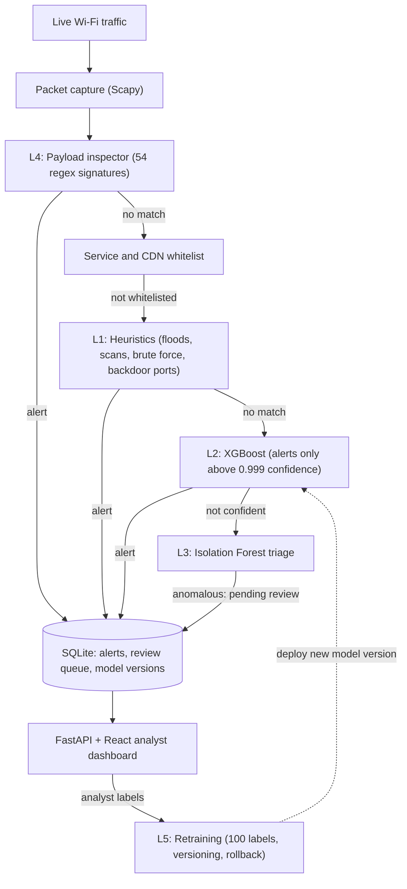
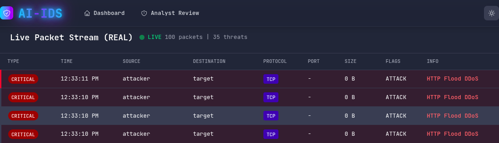
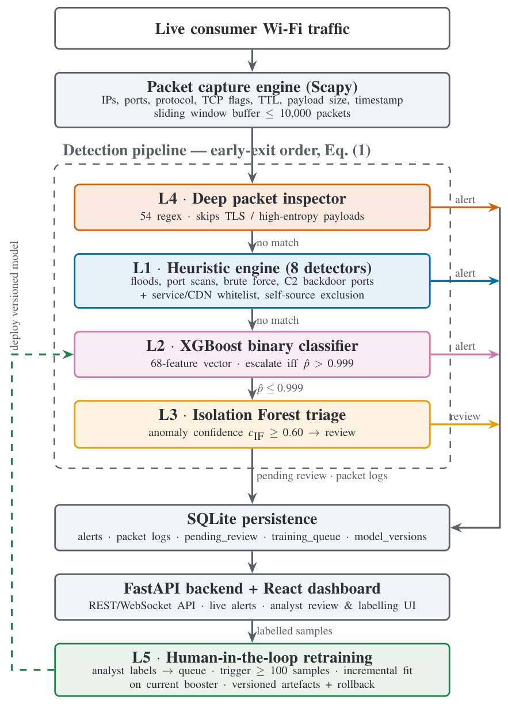
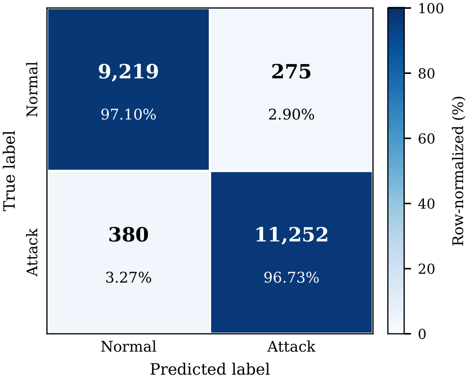
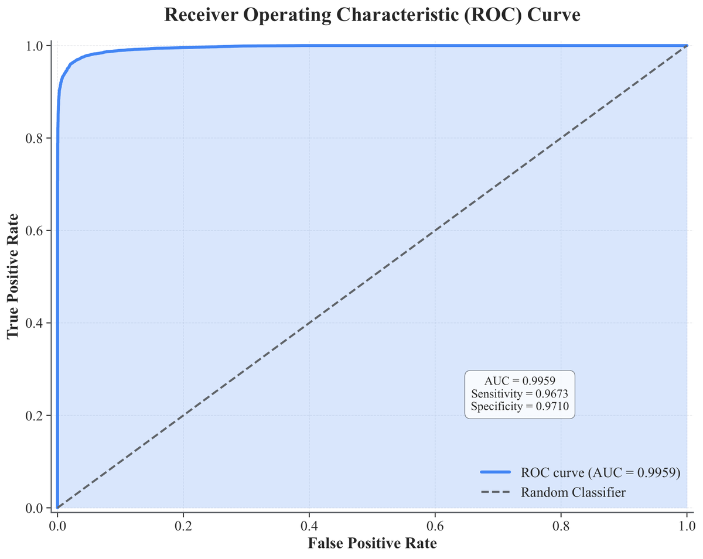
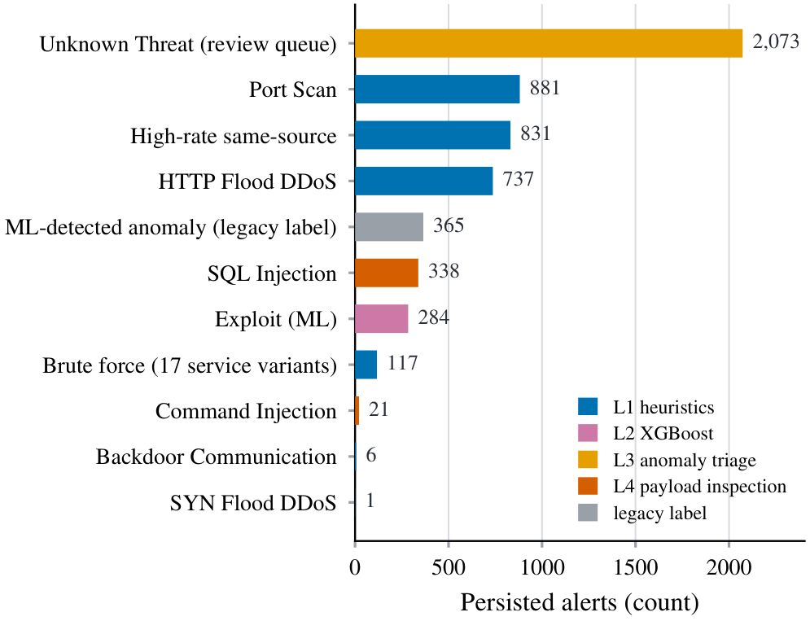

# Adaptive Network Intrusion Detection System with Human-in-the-Loop Retraining
> A full-stack network IDS that sniffs live traffic, runs every packet through layered detectors (payload signatures, flood and scan heuristics, an XGBoost classifier, anomaly triage), and lets an analyst label unknown threats to retrain the model, with versioning and rollback.

**Role:** Final-year thesis, B.S. Computer Science, FAST-NUCES (advisor: Ali Sayyed) · **Status:** Built in 2025 as my final-year project, with detection tuning continued into 2026. It's a research prototype that runs on one laptop and was tested on live Wi-Fi, not a production deployment. A paper describing it is in preparation (planned as an arXiv preprint). · **Source code:** private (code walkthrough or live demonstration available on request)

## The problem

Most intrusion detection systems rely on one method, and each kind fails in its own way:

- **Signature rules** catch known attacks precisely but miss anything new.
- **Machine-learning classifiers** generalise better but fire on benign traffic that happens to look unusual. On a real network that background noise trains operators to ignore alerts.
- **A model trained once goes stale.** What analysts learn while triaging alerts rarely makes it back into the model.

A high score on a benchmark dataset also doesn't make a sensor that stays quiet on a real network. I wanted a system that combines several detection methods, keeps false alarms down on live traffic, and turns analyst decisions into training data.

## What I built

A Python/FastAPI backend captures packets with Scapy and runs each one through a chain of detectors. Every alert is stored in SQLite and streamed to a React dashboard, and an analyst review page closes the feedback loop. The paper draft groups the detectors into five layers (L1–L5):

- **L1: Heuristic rule engine.** Eight detectors over rolling windows: SYN, UDP, ICMP and HTTP floods, port scans, brute force on authentication ports (with per-service thresholds), exact matches on 30 known backdoor/C2 ports, and a guard against a single source dominating traffic.
- **L2: XGBoost classifier.** A binary Normal-vs-Attack model trained on the UNSW-NB15 dataset with 68 input features. At runtime it raises an alert only when it is more than 99.9% confident.
- **L3: Isolation Forest triage.** An anomaly model over 5 packet features, fitted on a synthetic baseline of 950 normal service patterns (HTTP, HTTPS, DNS, high-port TCP/UDP). Together with a few behavioural rules, it sends "Unknown Threat" traffic to an analyst review queue.
- **L4: Deep packet inspection.** 54 regular-expression signatures across SQL injection (23), cross-site scripting (16), command injection (5) and reconnaissance-tool fingerprints such as nmap, sqlmap and nikto (10). It skips TLS, server responses and high-entropy payloads.
- **L5: Human-in-the-loop retraining.** Analyst labels go into a training queue. At 100 labels, XGBoost is fine-tuned from the current model rather than retrained from scratch. Each new model is saved as a timestamped version with its accuracy logged, and an admin endpoint rolls back to any earlier version.
- **Analyst dashboard.** React 18 + TypeScript. Alerts arrive live over a WebSocket, with HTTP polling as a fallback. An Analyst Review page lets you label pending threats (or mark them as false positives) and start retraining.
- **Attack-simulation scripts.** A launcher run from a phone on the same Wi-Fi reproduces floods, port scans, brute force, SQL injection and XSS payloads, backdoor-port probes, and crafted anomalous traffic, so live tests are repeatable.

## Architecture

The layer numbers are groupings. The runtime order differs and is tuned so that cheap, high-precision checks run first and the first match wins. A packet with a readable payload is checked against the regex signatures first. Then the whitelist drops traffic from major CDN and service providers, and the heuristics look for floods, scans, brute force and backdoor ports. Only packets that nothing else has explained reach the XGBoost model. If XGBoost isn't confident, the Isolation Forest scores the packet, and anything anomalous goes into the review queue. Analyst labels from that queue feed the retraining loop, which deploys a new versioned model back into L2.

## Key features

- **Early-exit cascade.** Most traffic is settled by header-only checks, so the classifier and anomaly model only see packets the cheaper layers couldn't explain.
- **Strict ML escalation.** XGBoost alerts only above 0.999 confidence. On live traffic it acts as a high-confidence second opinion rather than a noisy main detector.
- **False-positive controls:**
  - a service/CDN IP whitelist
  - port-scan logic that doesn't count authentication ports, so a host using several login services is treated as at most a brute-force candidate, not a scanner
  - the sensor's own address and loopback are excluded as flood sources
  - the payload inspector skips encrypted and binary traffic
- **Per-service brute-force thresholds.** Web logins (HTTP/HTTPS) get a higher threshold than SSH, FTP, database or RDP. In live testing, brute-force alerts appeared under 17 distinct service labels.
- **Versioned models with rollback.** Every retrain writes a new model file and a database row, and the previous version stays available, so a bad retrain can be undone.
- **Full audit trail.** Every alert is stored with its timestamp, source and destination, ports, protocol, severity, confidence and the detecting layer.

## Results

There are two kinds of evidence: the ML layer measured offline on a benchmark, and the full system run on a live network.

**XGBoost on UNSW-NB15** (from the saved metric files of the training run)

| What was measured | Result | How |
|---|---|---|
| Accuracy | **96.90%** | Binary Normal vs Attack. Held-out test split of **21,126 records** (9,494 normal, 11,632 attack) |
| Precision / Recall | **97.61% / 96.73%** | Same test split |
| F1 score | **97.17%** | Same test split |
| False-positive rate | **2.90%** (275 of 9,494 normal records flagged) | Same test split |
| False-negative rate | **3.27%** (380 of 11,632 attacks missed) | Same test split |
| ROC AUC / average precision | **0.9959 / 0.9969** | Same test split |
| Tuning | Best 3-fold cross-validated F1 **0.917** (30-trial random search) | Training split only. The test split wasn't used for tuning |
| Train / test accuracy | **95.5% / 96.9%** | Final model trained on training + validation splits |

**Full system on live Wi-Fi**

| What was measured | Result | How |
|---|---|---|
| Alerts recorded in the live test | **5,654 alerts over 18 days** (8–26 Oct 2025) | Counted from the system's own alert database. Attacks were launched from a phone on the same consumer Wi-Fi |
| Coverage by layer | Port scan 881 · high-rate source 831 · HTTP flood 737 · SQL injection 338 · XGBoost escalations 284 · brute force 117 · command injection 21 · backdoor port 6 · SYN flood 1 · unknown-threat triage 2,073 · older "ML anomaly" label from an earlier build 365 | Same database. Counts reflect how often each detector fired under my test workload, not detection rates |
| Payload signatures | **54 regex patterns** in 4 categories | Counted in the inspector |
| Model size | **≈447 KiB** on disk | XGBoost model file |

**How to read these numbers:**
- **The benchmark scores are per flow record, not per packet.** UNSW-NB15 rows describe whole network flows. The live system runs the same model on single packets and has to approximate or default the flow-level fields. So the 96.9% doesn't tell you how accurate the model is on live packets. That hasn't been measured, and it's one reason the live threshold is set at 0.999.
- **The split isn't the official UNSW-NB15 train/test partition.** The three split files together contain exactly the records and class counts of the official training and testing sets combined (257,673 records). The class counts show that validation and test were drawn only from the official testing set, and that training is the official training set plus the remaining ~38k testing-set records. So the scores can't be compared one-to-one with papers that use the official split. The script that built the split isn't in the project, so I can't confirm whether duplicate records were removed first. UNSW-NB15 has many duplicates, so some overlap between train and test is possible.
- **Single run, no confidence intervals.** I didn't train local baselines (Random Forest, SVM) on the same split, so I make no claim of beating other methods.
- **Latency and throughput weren't measured.** The pipeline has no timing instrumentation yet, so I don't report a per-packet latency figure.
- **The live false-positive rate on benign-only traffic wasn't measured** as a separate experiment.

## Tech stack

| Area | Tools |
|---|---|
| Backend / API | Python 3.13, FastAPI, Uvicorn, Pydantic, SQLAlchemy, WebSockets |
| Packet capture | Scapy (live sniffing in a background thread, bounded 10,000-packet buffer) |
| Detection / ML | XGBoost, scikit-learn (Isolation Forest, randomized search with cross-validation), pandas, NumPy, joblib |
| Storage | SQLite (alerts, packet logs, review queue, training queue, model versions) |
| Frontend | React 18, TypeScript, Vite, Tailwind CSS, Chart.js, React Router |
| Data | UNSW-NB15 (Moustafa & Slay, 2015) |
| Evaluation | Attack-simulation scripts run from a phone on the same network, matplotlib for figures |

## Screenshots

The figures come from the paper in preparation and were regenerated from the saved metrics and the alert database.

**Live dashboard during an HTTP-flood test** (cropped to the app. The build used in this test showed heuristic alerts with placeholder source and destination labels.)

**System architecture as implemented**

**Confusion matrix on the UNSW-NB15 test split.** 275 false positives and 380 missed attacks out of 21,126 records.

**ROC curve on the same test split (AUC 0.9959)**

**What fired during the 18-day live test, by detecting layer.** The large "Unknown Threat" bar is by design: I sent crafted anomalous traffic to exercise the review queue.

## Design decisions

- **Cheap, precise checks first, ML last.** A regex match on a SQL-injection payload or a hit on a known backdoor port is both cheaper and more trustworthy than a classifier score. Ordering detectors by cost and precision keeps the classifier off traffic that's already explained.
- **I made the classifier strict on purpose.** The model learned from flow records, but at runtime it sees single packets, so its borderline calls on live traffic aren't trustworthy. Instead of letting it flood the dashboard, it alerts only above 0.999 confidence and leaves the grey zone to the heuristics and the analyst queue.
- **Humans label, the model learns, and every model can be undone.** Retraining continues from the current model, so it keeps what it learned from UNSW-NB15. Every retrain is versioned with its accuracy logged, and rollback is one call. A bad batch of labels can't permanently damage the detector.
- **Fixing false positives found on a real network.** Running on my own Wi-Fi exposed noise the benchmark never shows. In a 2026 tuning pass I added these fixes. They came after the recorded live test and haven't been re-measured.
  - A DNS server's replies arriving on my laptop's ephemeral ports produced 285+ phantom DDoS alerts. Fix: only service ports (below 32768) count toward port diversity.
  - Multicast service-discovery traffic looked like backdoor ports. Fix: those detectors now only consider unicast destinations.
  - Heavy outbound traffic from the sensor itself was being flagged as an attack. Fix: every address the host owns (Wi-Fi, Docker bridges, IPv6) is excluded from flood detection.
- **I audited my own paper before writing it up.** I checked every claim in the draft against the code, the saved metrics and the alert database, and cut anything that wasn't backed. That included the planned MITRE ATT&CK layer, early latency estimates, and two literature baselines I couldn't verify.

## Honest limits

- **The ML numbers are benchmark-only** (UNSW-NB15, a 2015 benchmark dataset), computed per flow record on a custom re-split (see "How to read these numbers").
- **Possible dataset shortcut.** Source TTL alone accounts for 35% of the model's feature importance. TTL is a known artefact of the UNSW-NB15 testbed, so the benchmark score may overstate how well the model would transfer to another network.
- **Binary output only.** The model says Normal or Attack. It doesn't tell apart the 9 attack categories in the dataset.
- **The anomaly layer is a triage filter, not a validated zero-day detector.** It's fitted on synthetic normal traffic, its confidence levels are hand-set rather than calibrated, and it hasn't been benchmarked on held-out attacks.
- **The retraining loop is built but hasn't run a full cycle.** In the recorded deployment the queue held 3 labelled samples against a 100-label trigger, so no retrained model was produced and the accuracy benefit of retraining is unmeasured.
- **Plaintext only.** TLS traffic is skipped by design, so attacks over HTTPS are invisible to the payload inspector.
- **No adversarial testing.** The attack scripts reproduce standard tool-driven attacks. Nothing was designed to evade this detector (fragmentation, low-and-slow, payload mutation).
- **Small scale.** One laptop, one Wi-Fi network, one attacking phone. In the build used for the live test, the UDP and ICMP flood detectors couldn't actually fire (their thresholds exceeded their sampling window). That's why the live results show no UDP/ICMP alerts. I re-tuned them later.
- **The sixth layer was never built.** The thesis was proposed as "A Six-Layer Adaptive IDS with MITRE ATT&CK Mapping". The planned sixth layer, which would tag each alert with ATT&CK tactics and techniques, wasn't implemented. The paper draft describes five layers and lists ATT&CK mapping as future work.

## See it running
Source code is private to protect the work. I'm happy to walk through the code or give a live demonstration in an interview — contact **sulmn.cs@gmail.com** or [LinkedIn](https://linkedin.com/in/suliman-khan-2b9280251).

© 2026 Suliman Khan. All rights reserved.
