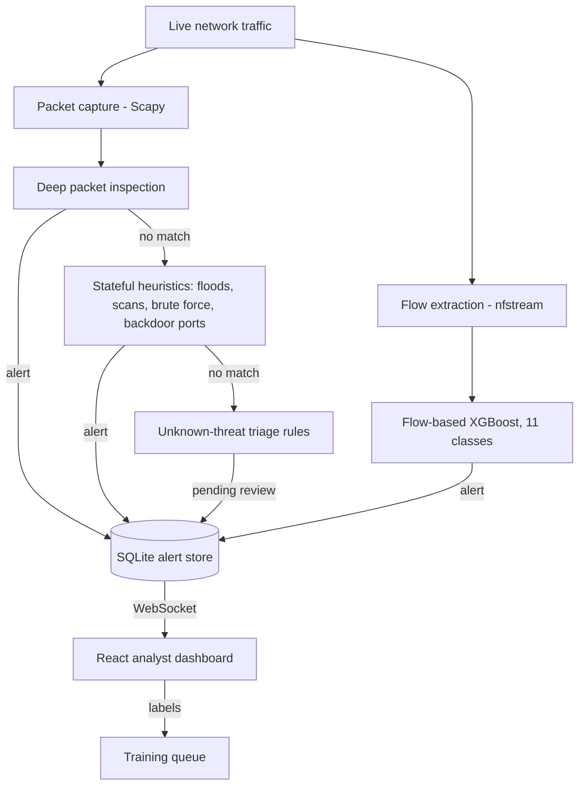
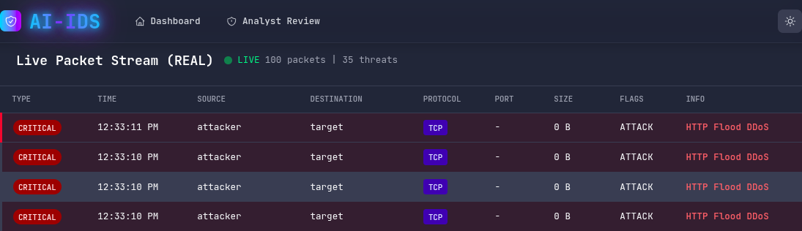
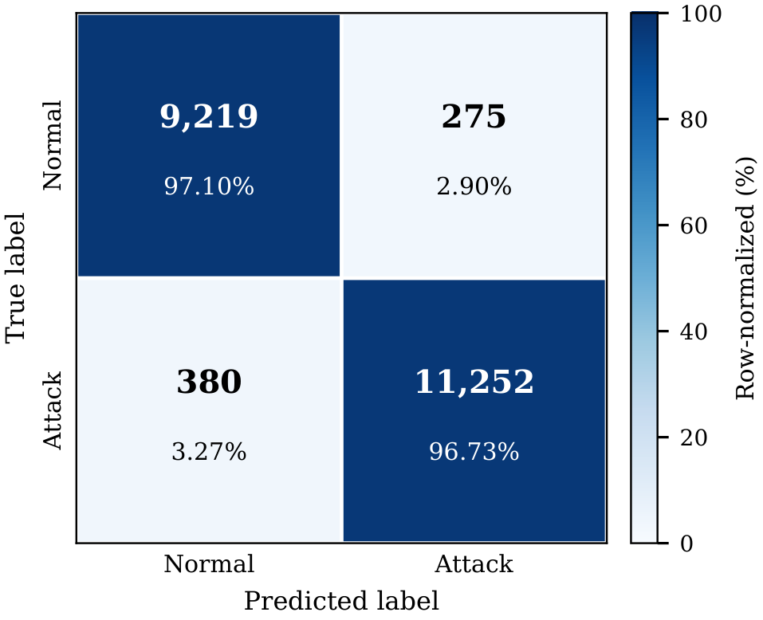
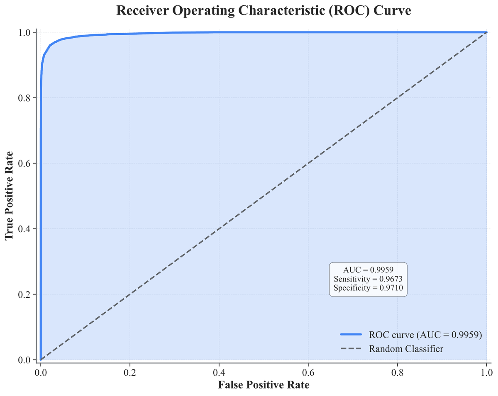

# Adaptive Network Intrusion Detection System
> A full-stack network IDS that inspects live traffic with layered detectors (payload signatures, stateful attack heuristics and machine learning), explains each alert to an analyst, and includes a self-built dataset and a live flow-based ML detector.

**Role:** Final-year project, B.S. Computer Science, FAST-NUCES · **Status:** Working research prototype on a single host with live Wi-Fi capture, not a production deployment. A paper is in preparation. · **Source code:** private (code walkthrough or live demonstration available on request)

## The problem

Most intrusion detection systems rely on one method, and each kind fails in its own way:

- **Signature rules** catch known attacks precisely but miss anything new.
- **Machine-learning classifiers** generalise better but fire on benign traffic that happens to look unusual. On a real network that noise trains operators to ignore alerts.
- **Benchmark scores don't transfer.** A model that scores well on a public dataset can fail completely on a different network.

The goal was a system that combines several detection methods, keeps false alarms down on live traffic, and keeps the analyst in the loop.

## What was built

The thesis proposed a **six-layer adaptive architecture**. A Python/FastAPI backend captures packets with Scapy and runs each one through a chain of detectors. Alerts are stored in SQLite and streamed to a React dashboard over WebSocket.

- **Deep packet inspection.** Regular-expression signatures for SQL injection (union, time-based, error-based and NoSQL variants), cross-site scripting, command injection, path traversal, brute-force markers for 14 protocols and reconnaissance-tool fingerprints. It scans both raw and URL-decoded payloads and skips TLS and binary data.
- **Stateful attack heuristics.** Rolling-window detectors for SYN, UDP, ICMP and HTTP floods, port scans, brute force on 16 login services (with per-service thresholds), connections to 31 known backdoor/C2 ports, multi-protocol reconnaissance and single-source traffic dominance.
- **XGBoost classifier.** A binary Normal-vs-Attack model trained on UNSW-NB15 (68 features), used as a high-confidence second opinion (alerts only above 0.999 confidence).
- **Unknown-threat triage.** Rule-based checks (oversized DNS and ICMP, DNS over TCP, large payloads on unusual ports and others) send suspicious traffic to an analyst review queue with human-readable reasons.
- **Analyst review workflow.** A review page shows why each alert fired; analysts label threats or mark false positives, and similar threats are labelled in one batch.
- **Adaptive retraining.** Automated retraining from analyst labels, with model versioning and rollback, is implemented in code but has not yet completed a full cycle.
- **Attack-simulation suite.** 29 attack generators with a launcher menu (floods, scans, brute force, SQL injection, XSS, backdoor probes), run from a phone on the same Wi-Fi so live tests are repeatable.

## From benchmark to real networks

**1. Testing whether public datasets transfer.** I combined two public NetFlow datasets, NF-UNSW-NB15-v2 (1,986,745 rows) and NF-ToN-IoT-v2 (2,000,000 rows sampled from 13.1M), harmonised them to 37 shared features and removed 3,213,056 duplicate rows (81%), leaving 773,689 flows.
- On a combined hold-out, XGBoost reached **97.8% accuracy** (F1 98.2%).
- **Trained on one dataset and tested on the other, it caught only 3.6% and 0.9% of attacks.**
- Conclusion: high benchmark scores say little about a new network. This led directly to building my own dataset.

**2. Building my own dataset: [LabFlow-NIDS](https://www.kaggle.com/datasets/sulimankhan0056/labflow-nids-flow-based-network-intrusion-dataset).** An isolated Docker network with web, SSH, FTP and DNS servers, a traffic generator simulating 22–60 users, and 10 scripted attack types per day (nmap, nikto, SQL injection, XSS, path traversal, SSH/FTP/HTTP brute force, SYN/UDP/ICMP/DNS floods). Flows were extracted with nfstream and labelled automatically from the attack timeline.
- **873,080 labelled flows** over 5 capture days, 58 behavioural features (IPs, ports and timestamps excluded), published on Kaggle under CC BY 4.0.

**3. Evaluating on a day the model never saw.** An 11-class XGBoost model trained on days 1–4 and tested on all of day 5 (152,232 flows):
- **Macro-F1 87.5%** and **balanced accuracy 89.9%**
- **99.96% of attacks detected at 0.34% false alarms** (attack vs benign)
- Weak spots: UDP and DNS floods are often confused with each other, and SSH brute force recall is 77%.

**4. Fixing a train/serve mismatch in the live system.** The first model was trained on whole flows but received single packets at runtime, so on live traffic it flagged almost everything. I disabled it in the live path and integrated a **flow-based detector**: nfstream extracts flows from the live interface exactly as in training, and the LabFlow-trained XGBoost model classifies each finished flow into 11 classes, running alongside the rule engine.

## Architecture (current)

Packet-level checks run in order of cost and precision, and the first match wins. In parallel, nfstream builds flows from the same interface and the flow model scores each completed flow. All alerts are stored and pushed live to the dashboard, where analysts review and label them.

## Results

**XGBoost on UNSW-NB15**

| What was measured | Result | How |
|---|---|---|
| Accuracy | **96.90%** | Binary Normal vs Attack, held-out split of 21,126 records |
| Precision / Recall | **97.61% / 96.73%** | Same split |
| F1 score | **97.17%** | Same split |
| False-positive rate | **2.90%** | Same split |
| ROC AUC | **0.9959** | Same split |
| Model comparison | XGBoost 96.9% vs SVM 92.5% accuracy | Same split |

**Cross-dataset test and own dataset**

| What was measured | Result |
|---|---|
| Cross-dataset transfer (NF-UNSW-NB15 ↔ NF-ToN-IoT) | Attack detection **3.6% / 0.9%** when tested on the other dataset |
| LabFlow-NIDS dataset | **873,080 flows**, 10 attack types, 5 days |
| Held-out-day evaluation (day 5) | **87.5% macro-F1**, **89.9% balanced accuracy**, 99.96% detection at 0.34% false alarms |

**How to read these numbers:** UNSW-NB15 results are per flow record on a custom re-split, not the official partition, and the model relies heavily on the source-TTL feature, a known artefact of that dataset. The LabFlow "unseen day" comes from the same environment and attack scripts with a different traffic load, so it tests stability over time rather than a new network.

## Tech stack

| Area | Tools |
|---|---|
| Backend / API | Python, FastAPI, Uvicorn, SQLAlchemy, WebSockets |
| Capture & flows | Scapy, nfstream, tcpdump |
| Detection / ML | XGBoost, scikit-learn, pandas, NumPy |
| Storage | SQLite |
| Frontend | React 18, TypeScript, Vite, Tailwind CSS, Chart.js |
| Data | UNSW-NB15, NF-UNSW-NB15-v2, NF-ToN-IoT-v2, LabFlow-NIDS (own) |
| Lab & attacks | Docker Compose, nginx, OpenSSH, vsftpd, CoreDNS, nmap, nikto, hping3 |

## Screenshots

**Live dashboard during an HTTP-flood test** (cropped to the application)

**Confusion matrix on the UNSW-NB15 test split.** 275 false positives and 380 missed attacks out of 21,126 records.

**ROC curve on the same test split (AUC 0.9959)**

## Design decisions

- **Cheap, precise checks first, ML last.** A signature match on a SQL-injection payload or a hit on a known backdoor port is cheaper and more trustworthy than a classifier score, so those run first.
- **Measure transfer before trusting a benchmark.** The cross-dataset test showed near-zero transfer, which is why I built a dataset from a controlled environment instead of chasing benchmark accuracy.
- **Train and serve the same way.** The live flow detector uses the same nfstream settings and feature set as training, removing the packet-versus-flow mismatch that made the first model unusable on live traffic.
- **Drop shortcut features.** IPs, ports and timestamps are excluded from LabFlow training so the model learns attack behaviour, not the environment.
- **False-positive engineering for live Wi-Fi.** The sensor ignores its own addresses and the gateway, tracks which side opened a connection, counts only service ports toward scan detection, and keeps a confirmed attacker labelled for 60 seconds so one attack isn't reported under several names.

## Honest limits

- **Single-host scale.** One laptop, one Wi-Fi network and one environment; not tested on enterprise traffic.
- **The flow detector still needs tuning on real home traffic.** It is accurate on held-out lab data but raises too many false alarms on everyday traffic from a different network; tuning is in progress.
- **Plaintext payload inspection only.** Attacks inside TLS are invisible to the signature layer by design.
- **No adversarial testing.** The attack scripts reproduce standard tool-driven attacks, not attacks designed to evade this detector.
- **Planned work:** completing the automated retraining cycle and mixing real benign traffic into the training data.

## See it running
Source code is private to protect the work. I'm happy to walk through the code or give a live demonstration in an interview — contact **sulmn.cs@gmail.com** or [LinkedIn](https://linkedin.com/in/suliman-khan-2b9280251).

© 2026 Suliman Khan. All rights reserved.
