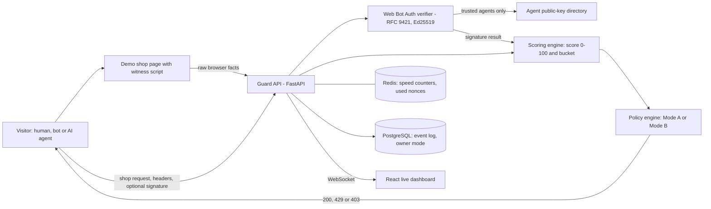
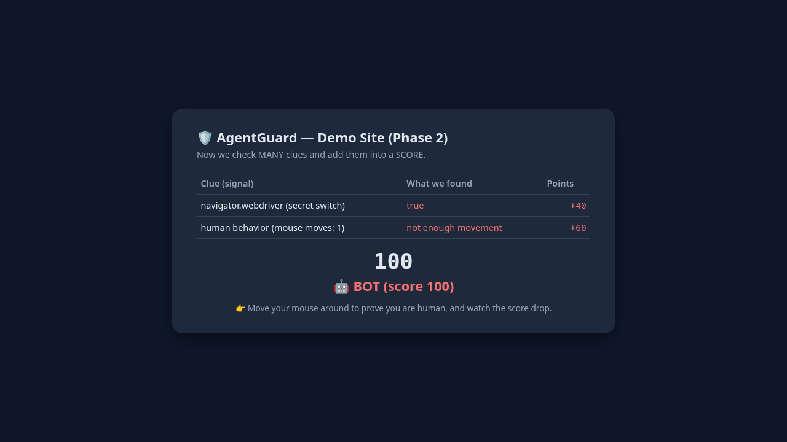
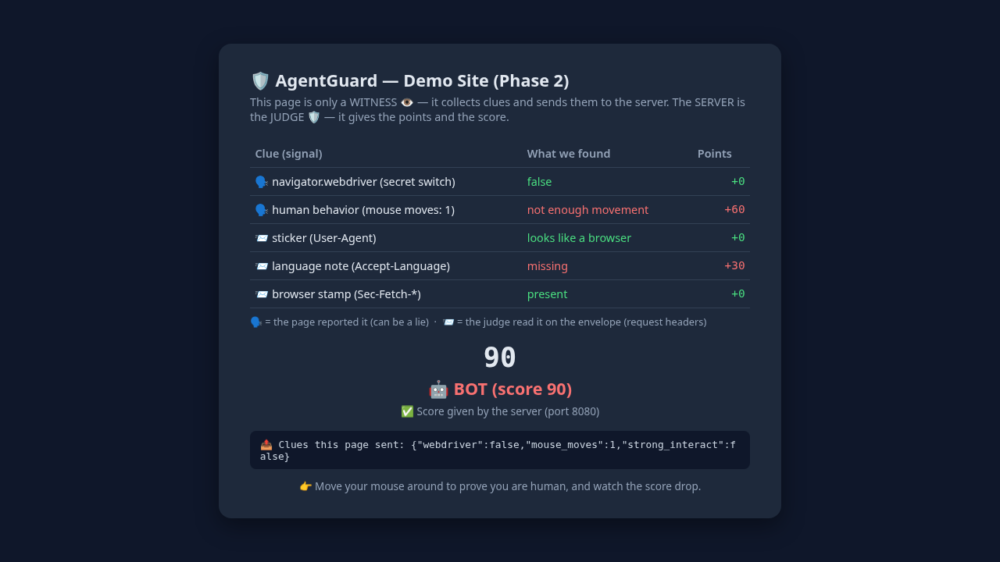

# AgentGuard

> A self-hosted service that scores every website visitor from 0 to 100, separates humans from bots and from cryptographically verified AI agents, and lets the site owner choose whether agents are blocked or welcomed under rate limits.

**Role:** Solo — designed and built end to end · **Status:** Working personal learning project — the full stack starts locally with one `docker compose up`; not production-hardened · **Source code:** private (walkthrough or live demo available on request)

## The problem

AI agents now browse the web on behalf of people, and scripted bots scrape and flood sites. A website owner has to answer two questions for every visit: *who is this* (a human, an honest AI agent, or a bot?) and *what should I do about it?*

The obvious clue, the `User-Agent` header, is written by the visitor and can say anything. Large sites buy commercial bot protection; small businesses and public-sector sites usually cannot. I wanted to understand how this detection really works by building a small, honest version of it and then attacking it with my own bots.

## What I built

AgentGuard is a guard service that sits in front of a demo shop. A small script on the page reports raw browser facts. The server combines those facts with request headers, request speed and, for AI agents, a cryptographic signature. It turns them into a score and a verdict, and the owner's policy decides whether the request gets **200 OK**, **429 Too Many Requests** or **403 Forbidden**.

- **Guard API** (Python, FastAPI): the scoring engine, a Web Bot Auth signature verifier, a policy engine, a protected shop endpoint, and event, stats and WebSocket endpoints.
- **Demo shop page**: a "witness" script that reports facts such as whether the browser is automated and whether real human input happened. It never scores itself.
- **Live dashboard** (React, TypeScript, Vite): visitor counters, a live event table showing which clues caught each visitor, and the owner's Mode A / Mode B switch.
- **Storage**: Redis for short-lived state (speed counters, used signature nonces, latest page report) and PostgreSQL for a permanent event log and the owner's chosen mode.
- **Red-team bots**: 9 bots of my own, 8 attackers and 1 honest signed agent. I used them to test the detector and fix what they got past.
- **Packaging**: Docker Compose with 5 services, ports bound to `127.0.0.1` only, and a non-root API container.

## Architecture

The page is only a witness: it sends facts, and the server acts as judge. On each request the API reads the headers, measures the visitor's speed in Redis and, if the request is signed, checks the signature against the agent's published public key. The scoring engine turns the clues into a score and a bucket (human, verified agent, suspicious or bot). The policy engine then maps that bucket to an HTTP response according to the owner's current mode. Every judgment is written to PostgreSQL and pushed over a WebSocket to the dashboard.

## Key features

**Multi-signal scoring.** No single clue decides. Each bot-like clue adds points (the score is capped at 100):

| Clue | Source | Bot-like when |
|---|---|---|
| Browser automation flag (`navigator.webdriver`) | page report | automation is driving the browser |
| Human input | page report | fewer than 5 real mouse moves and no wheel, key, click or touch |
| `User-Agent` | request header | contains a known bot or tool word |
| `Accept-Language` / `Sec-Fetch-*` | request headers | missing (scripts and headless browsers often omit them) |
| Speed | measured server-side in Redis | more than 15 reports in 10 seconds |
| Web Bot Auth signature | cryptographic | present but forged, altered, copied or expired |

Scores of 0–29 are **human**, 30–69 **suspicious** and 70–100 **bot**. A valid signature puts the visitor in the **verified agent** bucket.

**Web Bot Auth verification (IETF draft on RFC 9421 HTTP Message Signatures, Ed25519).**
- Rebuilds the signature base exactly as the RFC defines it and verifies the Ed25519 signature.
- Fetches public keys **only** for agents on a trusted list, never follows redirects (SSRF protection) and caches keys for 5 minutes.
- Checks `created` and `expires`, plus a stricter rule of my own: no signature may be valid for more than 24 hours.
- Stores every used nonce in Redis until the signature expires, so a copied ("replayed") request is rejected even seconds later.

**Owner policy in two modes.** Detection decides *who* the visitor is; the policy decides *what to do*.

| | Human | Verified agent | Suspicious | Bot |
|---|---|---|---|---|
| **Mode A — Protect** | allow | block | 3 requests / min | block |
| **Mode B — Welcome** | allow | 5 requests / min | 3 requests / min | block |

Anyone can read the current mode, but changing it requires an admin key.

**Live dashboard.** Built on a WebSocket stream that checks the `Origin` header. Rows flash in as visitors arrive, and the dashboard reconnects on its own if the API restarts.

**Privacy by design.** No raw IP addresses are stored, only a keyed HMAC-SHA256 hash of IP + User-Agent. The page sends event *counts*, never keystrokes or mouse paths, and Redis entries expire on their own (10 seconds to 10 minutes).

## Results

All numbers below come from the project's test suite and my recorded experiments. The detector has only run against my own demo shop with my own bots.

- **29 automated tests, all passing** (pytest): 11 for scoring, 6 for policy and 12 for Web Bot Auth.
- **Checked against the IETF draft's official test vectors.** The verifier accepts both signed examples published in the Web Bot Auth draft (Appendix E.2.1 and E.2.2) and reproduces the draft's key ID (JWK thumbprint). It rejects the same examples when they are sent to another site, have the signer changed, or have expired. A separate conformance script passes **7 of 7** checks.
- **Red-teamed with 8 attacker bots plus 1 honest agent.** Results as recorded in my project journal:

| Bot | Its trick | What caught it | Recorded result |
|---|---|---|---|
| simple bot | plain automated browser | automation flag | score 100 → bot |
| sneaky bot | fake Chrome `User-Agent` | automation flag (checks what it *is*, not what it *says*) | score 100 → bot |
| ninja bot | hides the automation flag | no human input + missing `Accept-Language` | score 90 → bot |
| liar bot | no browser; sends fake "human" facts to the API | request headers give it away | score 100 → bot |
| smart liar bot | fakes the facts *and* the headers | speed, measured on the server | human for 15 reports, **bot from report 16** |
| scraper bot | perfect disguise, 20 fast shop requests | rate limit, then speed | 200 ×3 → 429 ×12 → 403 ×5 |
| fake agent bot | claims to be the honest agent, without its key | signature check | rejected → 403 |
| replay agent bot | resends a copy of a real signed request | expiry, site binding and nonce reuse | rejected → 403 |
| GoodBot (honest) | signs every request with its own key | valid signature → verified agent | **Mode A: 403 · Mode B: 200 ×5, then 429** |

The same honest agent, with the same valid signature, was blocked in Mode A and admitted in Mode B. Only the owner's switch changed.

**Detection bugs I found by attacking my own detector:**
- Headless Chromium fires one synthetic mouse move on page load, which briefly made a bot look human. I raised the threshold to 5 real moves.
- After a reload, Firefox restores the scroll position, and my page counted that as human input. It now counts only trusted wheel, key, click and touch events.
- A fresh copy of a valid signed request was accepted within its 1-minute lifetime. Tracking each nonce in Redis closed the gap.

**Known limits (stated in the project itself).** Every browser clue can be faked by a determined bot. The weights are hand-picked, not learned from real traffic, so I have **no real-world accuracy numbers**. Slow bots and bots spread across many IP addresses get past the speed clue. Web Bot Auth is still a draft, and I support only Ed25519 and a fixed set of signed components. There is no TLS or real login, and it is not load-tested. Suspicious visitors are rate-limited; there is no interactive "prove you're human" challenge.

## Tech stack

| Area | Tools |
|---|---|
| Backend | Python, FastAPI, Uvicorn, WebSocket |
| Security | Web Bot Auth (IETF draft), RFC 9421 HTTP Message Signatures, Ed25519 (`cryptography`), HMAC-SHA256 |
| Data | Redis, PostgreSQL |
| Frontend | React, TypeScript, Vite |
| Testing & red-team | pytest, Playwright (headless Chromium), custom Python attack scripts |
| Delivery | Docker, Docker Compose, nginx |

## Screenshots

Early version of the demo page, captured by my own headless bots. The page lists each clue and its points, and the server returns the score.

| Simple bot caught by the automation flag | Ninja bot caught despite hiding the flag |
|---|---|
|  |  |

## Design decisions

- **The page is a witness; the server is the judge.** The browser belongs to the visitor, and the visitor may be a bot. Scoring in the browser would let a bot grade its own exam, so the page only reports facts and every score is computed server-side.
- **Many weak signals plus one strong one.** Any single browser or header clue can be faked, so the score combines several of them. A signature check gives the one clue a bot cannot fake without the agent's private key.
- **Detection separated from policy.** The same detector serves two business choices: keep agents out, or welcome verified agents with limits. The owner changes a mode, not code.
- **Locked-down key fetching.** The verifier fetches keys only from allow-listed agents, never follows redirects, and caps how long a signature can stay valid. That stops attackers from using the verifier to make arbitrary outbound requests, and it limits replay.
- **Fail open when a data store is down.** If Redis or PostgreSQL is unavailable, scoring still runs and only the speed check or logging is skipped, so real visitors aren't locked out. This is a deliberate trade-off, and I document it.

## See it running

Source code is private to protect the work. I'm happy to walk through the code or give a live demo in an interview — contact **sulmn.cs@gmail.com** or [LinkedIn](https://linkedin.com/in/suliman-khan-2b9280251).

© 2026 Suliman Khan. All rights reserved.
