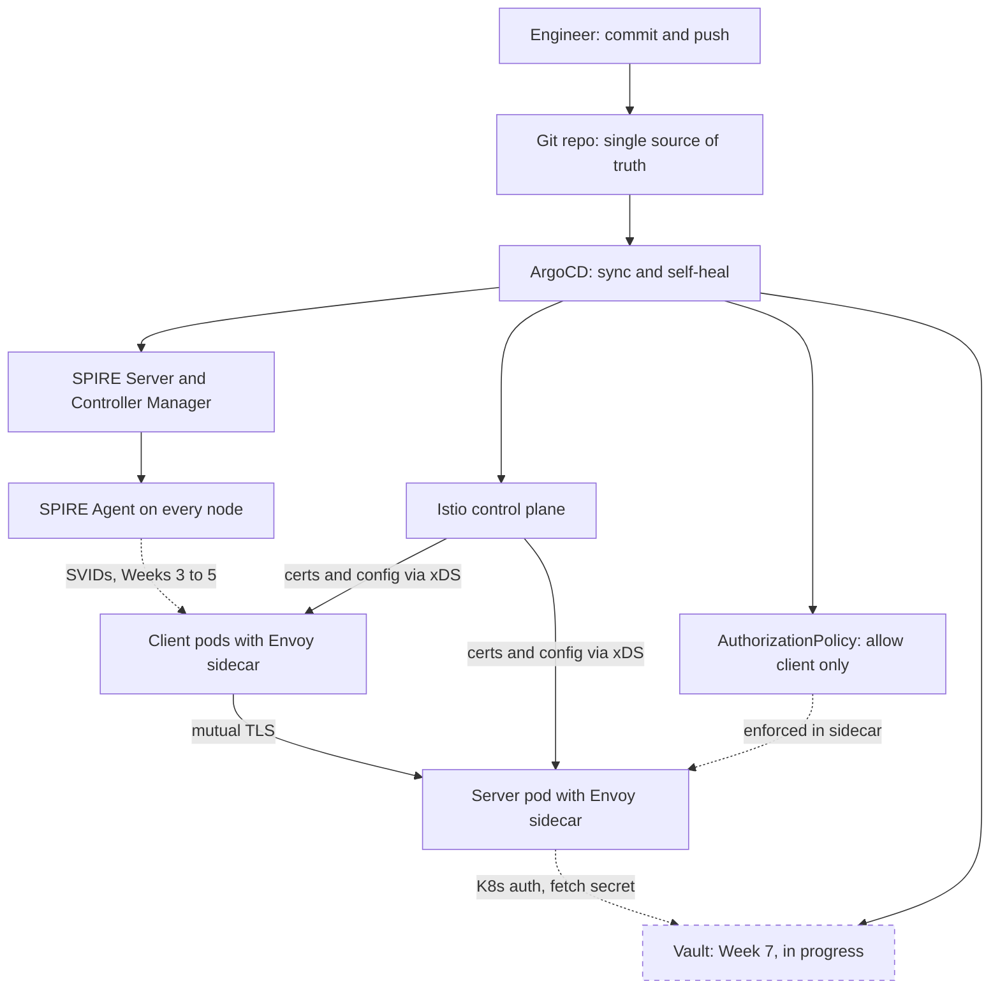

# GitOps-Native Zero-Trust Kubernetes
> A Kubernetes cluster where every workload gets a cryptographic identity, services authenticate each other with mutual TLS, access is granted by identity instead of network location, and the whole security posture lives in Git, where every change is reviewed and any manual drift is reverted automatically.

**Role:** Solo — designed and built end to end · **Status:** In progress. Weeks 1–6 of a 10-week plan are complete and documented, and Week 7 (Vault) is under way. It runs on a local 3-node kind cluster. · **Source code:** private (code walkthrough or live demonstration available on request)

## The problem

Most Kubernetes clusters trust the network. Any pod can call any other pod unless someone remembered to write a NetworkPolicy. Service-account tokens and cloud keys end up copied into ConfigMaps and environment variables. Security settings drift whenever someone runs a manual kubectl command. One compromised pod can then move sideways across the whole cluster.

Zero trust flips those defaults:

- Every workload proves **who it is** with a short-lived certificate.
- Every connection is **mutually authenticated and encrypted**.
- Access rules name **identities**, not IP addresses or namespaces.
- The only way to change any of this is a **commit to Git**.

## What I built

I'm building a GitOps-managed zero-trust platform one week at a time. Each component is deployed by ArgoCD from Git, and each week ends with a verification run and a written log.

**Done so far (Weeks 1–6):**
- **GitOps foundation.** ArgoCD v3.3.9 (pinned upstream, installed with Kustomize) syncs the cluster from Git with automatic self-heal. Each component is its own ArgoCD Application.
- **Workload identity authority.** A SPIRE Server 1.14.6 issues identities for the trust domain `p5.local`. It runs as a StatefulSet on persistent storage so its signing keys survive restarts, and it uses the Kubernetes PSAT node attestor.
- **Per-node agents.** A SPIRE Agent DaemonSet runs on all three nodes. Each agent proves its node's identity to the server, then hands short-lived X.509 certificates (SVIDs) to pods through a local socket.
- **Identities declared in Git.** SPIRE Controller Manager 0.6.4 runs as a sidecar and turns `ClusterSPIFFEID` and `ClusterStaticEntry` resources stored in Git into SPIRE registration entries. Each pod gets its own entry, tied to its pod UID.
- **SPIFFE mTLS between two Go services.** A client and a server, both hand-written in Go, authenticate each other with SPIFFE certificates. Each side pins the other's identity during the TLS handshake. Both run as hardened, distroless, non-root containers.
- **Service mesh.** Istio 1.24.1 (Envoy sidecars) took over mTLS, so the apps became plain HTTP. An `AuthorizationPolicy` lets only the client's identity reach the server.

**In progress (Week 7):**
- HashiCorp Vault is installed through ArgoCD.
- The server now fetches its secret from Vault at runtime using Kubernetes service-account auth, instead of reading a static credential.
- A fully SPIFFE-based Vault login is planned but blocked by the attestation issue described under Design decisions.

**Planned, not started:**
- OPA/Gatekeeper identity-based admission policies
- Automated drift-detection tests
- An "attacker pod" chaos test
- An App-of-Apps root application and diagrams/runbook

## Architecture

Everything starts with a Git commit. ArgoCD pulls the change into the cluster and reverts anything changed by hand. In Weeks 3–5, SPIRE issued identities straight to the workloads, and the Go services did SPIFFE mTLS themselves. From Week 6, Istio sidecars handle mTLS transparently using the same `p5.local` trust domain. The receiving sidecar checks the caller's verified identity against the AuthorizationPolicy before the request ever reaches the application. Vault (dashed) is the current work in progress.

## Key features

- **Git is the only way to change state.** After a one-time bootstrap, every change went through a commit. That includes revoking access. Deleting a resource by hand doesn't stick, because ArgoCD puts it back.
- **Cryptographic workload identity.** Nodes and pods are identified by SPIFFE IDs such as `spiffe://p5.local/...` instead of IP addresses. Certificates are short-lived, rotate automatically and never touch disk.
- **Per-pod registration entries.** Entries are keyed to the pod's UID, not just its namespace and service account. They are created from YAML and cleaned up automatically when a pod is deleted.
- **Authorization at the identity layer.** In Week 5 the TLS handshake itself rejected the wrong peer. In Week 6 the Istio sidecar rejects unauthorised callers with HTTP 403, so application code never has to remember an auth check.
- **Revocation through a pull request.**
  - Week 5: removing a workload's identity file from Git stopped it getting new certificates.
  - Week 6: changing one principal in the policy file cut off access within seconds.
  - In both cases, reverting the commit restored access.
- **Hardened containers.** Distroless non-root images, a read-only root filesystem, all Linux capabilities dropped, no privilege escalation and a seccomp RuntimeDefault profile. In Week 5, the SPIRE agent socket was also mounted read-only.

## Results

Everything below was measured on my local 3-node kind cluster and recorded in my weekly logs.

| What was tested | Result |
|---|---|
| ArgoCD self-heal | 4 out-of-band changes (manual scale, image change, deleted Service, deleted Deployment) were all reverted or recreated automatically. The scale and image changes were reverted within about 30 s. A 5th test confirmed that a change made in Git was applied cleanly. |
| Node attestation | **3 / 3** SPIRE agents attested to the server (one per node) |
| Identity entries from Git | The controller created **4** SPIRE entries from YAML (one per workload pod plus a node alias). A brand-new test pod received its certificate in about 4 s. |
| SPIFFE mTLS | The client logged continuous `OK` responses carrying the server's verified SPIFFE ID, and the server echoed back the client's verified ID |
| Identity revocation via Git (Week 5) | Registration entries dropped from 5 to 2 about 10 s after the revoke commit. Restarted pods couldn't get a certificate. The full revoke-and-restore cycle took about 3.5 minutes. |
| Policy revocation via Git (Week 6) | Client calls flipped from `OK` to `403 RBAC: access denied` about 25 s after the policy edit. After a revert commit, calls returned to `OK` at about the 45-second mark. |

The comparison showed something real. Identity revocation is limited by how long existing certificates stay valid: running pods kept working on cached certificates until they were restarted. Mesh policy changes take effect as soon as the sidecars receive new config.

## Tech stack

| Area | Tools |
|---|---|
| Platform | Kubernetes (kind, 1 control-plane + 2 workers), Docker |
| GitOps | ArgoCD v3.3.9, Kustomize, Helm charts deployed through ArgoCD |
| Workload identity | SPIFFE, SPIRE Server and Agent 1.14.6, SPIRE Controller Manager 0.6.4, spiffe-csi-driver |
| Service mesh | Istio 1.24.1 (istiod and Envoy sidecars), AuthorizationPolicy |
| Secrets | HashiCorp Vault (Helm chart 0.30.0), in progress |
| Workloads | Go (go-spiffe v2 for hand-written mTLS, then standard-library HTTP behind the mesh), distroless images |
| Planned | OPA/Gatekeeper |

## Design decisions

- **Pull-based GitOps with self-heal turned on.** The cluster pulls from Git, so nothing outside needs inbound access to it. Self-heal makes Git the real source of truth. I learned this when a manual `kubectl delete` of an identity was quietly undone within about 30 s: revocation has to be a commit.
- **Identities as reviewed YAML, not CLI commands.** I replaced hand-made SPIRE entries with CRDs managed by the controller, so identities survive a cluster rebuild and go through code review. The default parent-ID template didn't match how PSAT-attested agents are named, so I chained entries to a cluster-wide node alias instead.
- **Policies name principals, not namespaces.** Namespaces are labels anyone with access can change. A principal comes from the certificate the caller presented during the mTLS handshake, so it is cryptographically anchored.
- **An honest fallback instead of a hidden gap.** The original plan was for SPIRE to be the certificate authority for Istio. On kind with cgroup v2 and SPIRE 1.14.6, the agent couldn't reliably map sidecar processes to pods, so I fell back to Istio's built-in CA:
  - I kept the same `p5.local` trust domain, so the policies won't change when SPIRE takes over later.
  - I documented this as deferred, along with three possible ways forward.
  - Mesh mTLS is still at Istio's default "permissive" mode. Moving to strict is on the list.
- **One ArgoCD Application per service.** When I revoked the client's access, the server's Application stayed healthy and in sync. Bundling them would have hidden a deliberate change behind a confusing "OutOfSync" warning.

## See it running
Source code is private to protect the work. I'm happy to walk through the code or give a live demonstration in an interview — contact **sulmn.cs@gmail.com** or [LinkedIn](https://linkedin.com/in/suliman-khan-2b9280251).

© 2026 Suliman Khan. All rights reserved.
