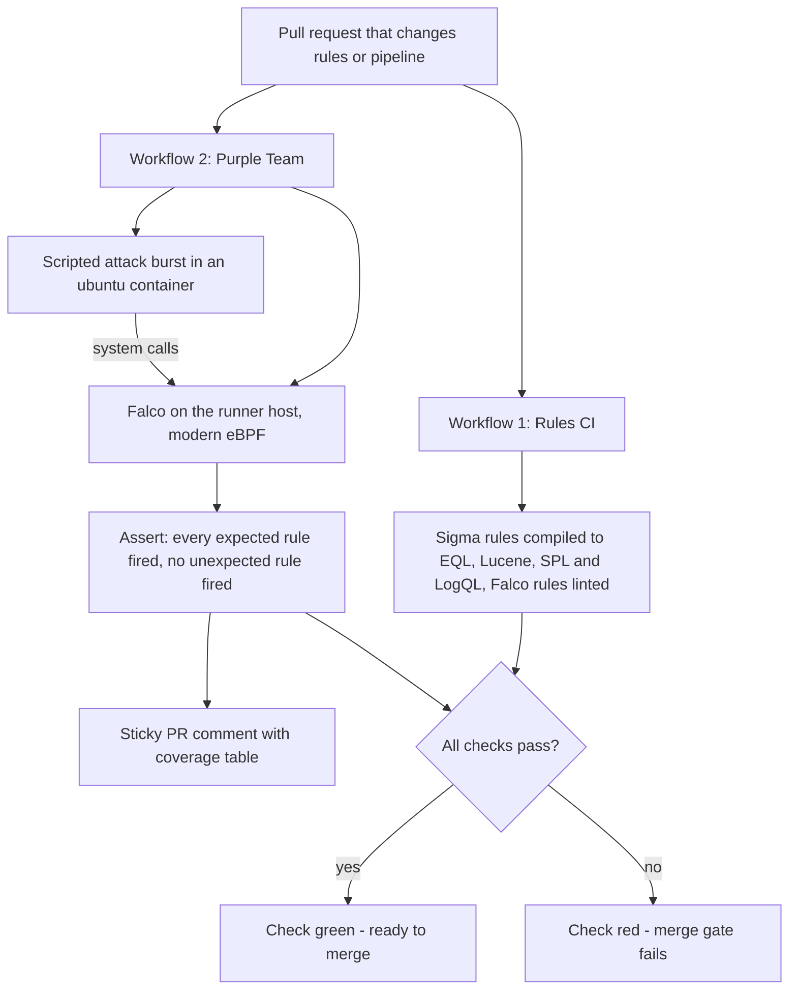

# Purple-Team Detection-as-Code

> A CI pipeline that attacks itself whenever a detection rule changes: it runs scripted Linux attack commands under Falco on a fresh GitHub Actions runner, and fails the pull request if an expected detection doesn't fire or an unexpected one does.

**Role:** Solo — designed and built end to end · **Status:** Complete 8-week portfolio build; both CI workflows live in the public repo · **Source code:** public — [github.com/Suliman8/purple-team-detection-as-code](https://github.com/Suliman8/purple-team-detection-as-code)

## The problem

Detection engineers write rules that are supposed to fire when an attacker does something specific. Most of those rules are never tested against the attack they are meant to catch. A rule that exists but has never been proven is arguably worse than having no rule at all, because the team *believes* it is covered.

Two more failure modes go unnoticed without automation: a rule change can silently break a detection, and a rule can start firing on normal system activity, flooding analysts with false alarms. I wanted every rule change to prove, automatically, that the detections still work.

## What I built

A detection-as-code repository with two CI gates. One proves every rule compiles for real SIEM platforms. The other proves the rules catch real attack behaviour.

- **Detection rules**: 21 Sigma rules (one per technique file) and 20 hand-written Falco runtime rules that mirror them. The 21st Sigma rule, a default-credential login, watches web-server logs rather than system calls. Together the rule files are tagged with **22 MITRE ATT&CK techniques**.
- **Multi-SIEM compile pipeline**: translates every Sigma rule into 4 query languages (Elastic EQL, Kibana Lucene, Splunk SPL and Grafana LogQL). The run fails if any single conversion fails.
- **Workflow 1, Rules CI**: checks Sigma syntax, compiles all rules to all 4 backends, lints the Falco rules offline and uploads the compiled rule pack as a build artifact.
- **Workflow 2, Purple Team**: starts Falco (modern eBPF) on the GitHub runner, runs a scripted attack burst inside a throwaway `ubuntu:22.04` container, then asserts exactly which detections fired and posts a coverage table as a sticky PR comment.
- **ATT&CK coverage heatmap**: a script that exports a MITRE ATT&CK Navigator layer. Green means the rule exists and CI proves it fires, yellow means the rule exists but is untested, and gray means there is no rule.
- **Kubernetes cyber range** (kind): an isolated namespace with NetworkPolicies and a ResourceQuota, an OWASP Juice Shop target and a "compromised host" pod. I wired in the third-party adversary-emulation tools MITRE Caldera and Atomic Red Team for manual attack exercises.
- **One-command local run**: `./scripts/demo.sh` compiles the rules, runs the live attack-and-detect check and exports the heatmap.

## Architecture

Both workflows run on pull requests to `main` that touch the rules, the Falco configuration, or the pipeline scripts; docs-only changes skip them. Workflow 1 is the "does it compile" gate. Workflow 2 is the "does it actually detect" gate. Falco watches the system calls made by the attack container, and a Bash + `jq` assertion compares the alerts against the expected set of techniques. A missing detection *or* an unexpected one fails the job, and the result is written back to the pull request as a single, self-updating comment.

## Key features

- **Two-sided assertion.** The attack gate fails if an expected technique stays silent (a broken rule) *and* if a technique fires that shouldn't (a false positive). Checking only one direction would let regressions or noise slip through.
- **Write once, deploy to four SIEMs.** Sigma is the single source of truth, and the compiled queries are regenerated by CI rather than committed.
- **Honest coverage reporting.** The heatmap separates "rule exists" from "rule proven in CI", so untested coverage can't pass as real coverage.
- **CI hygiene.** Path-filtered triggers, cancellation of stale runs, pinned toolchain versions, build artifacts with 14-day retention, an automatic Falco log dump on failure, and sticky PR comments that update in place instead of piling up.
- **Reproducible locally.** The same attack-and-assert script runs on a developer machine through `./scripts/setup.sh` and `./scripts/demo.sh`.

## Results

Counts come from the repository files. Coverage figures come from the CI assertion script and the exported heatmap layer, and timings are from my build notes.

| Metric | Value | How it was established |
|---|---:|---|
| Sigma detection rules | **21** | rule files in `rules/` |
| Falco runtime rules | **20** | rules in the custom Falco rule file |
| MITRE ATT&CK techniques covered | **22** | unique technique tags across the Sigma rules (matches the heatmap layer) |
| Techniques CI-verified against attack commands | **15** | the expected set the purple-team gate asserts on every run |
| Compiled SIEM queries per run | **84** | 21 rules × 4 backends; I re-ran the pipeline: 84 succeeded, 0 failed |
| Verified coverage before → after the Week 7 gap analysis | **5 → 15** | heatmap layers from Weeks 6 and 7 |
| Production-relevant false positive caught by CI | **1** | see below |
| Failed CI runs before the attack gate went green | **8** | documented failure log from Week 5 |
| Typical CI time | **~50 s** compile gate · **~3 min** attack gate | approximate, from my Week 5 notes |

**Coverage at a glance:**

| Status | Behaviours |
|---|---|
| **Verified in CI (15)** | shell recon commands; reads of `/etc/passwd` and `/etc/shadow`; process discovery; file discovery for keys; SSH private-key access; `authorized_keys` tampering; local account creation; bash-history clearing; SUID-style `find -exec` abuse; base64 decode-and-execute; security-software discovery; remote-system discovery; network-configuration discovery; system-information discovery |
| **Rule written, not yet exercised in CI (7)** | user discovery; cron persistence; log-file deletion; HTTP beaconing to unusual ports; default-credential web logins; web-shell drops; container escape via host mounts |

Some of the untested rules need conditions a single throwaway container doesn't provide: an outbound destination for beaconing, a running web server for web shells, and a privileged container for escapes. I list all seven as future work rather than claiming them as covered.

**The false positive the gate caught.** When I extended the attack burst with package installs, the cron-persistence rule fired. The cause was not the attack: the runner host's own `dockerd` and package tooling were writing to cron paths *on the host*. In production, that rule would have alerted on every package update on every node. I fixed it in two iterations, first by excluding package-manager ancestry and then by scoping the rule to containers only. This was caught before the rule ever reached a real cluster.

## Tech stack

| Area | Tools |
|---|---|
| Detection | Sigma, pySigma / sigma-cli, Falco (modern eBPF), MITRE ATT&CK, ATT&CK Navigator |
| SIEM targets | Elastic EQL, Kibana Lucene, Splunk SPL, Grafana Loki LogQL |
| CI/CD | GitHub Actions, sticky PR comments, build artifacts |
| Infrastructure | Docker, Kubernetes (kind), Helm, NetworkPolicy, ResourceQuota |
| Scripting | Bash, Python 3.11, `jq` |
| Third-party range tools I integrated | MITRE Caldera (Sandcat agent), Atomic Red Team, OWASP Juice Shop |

## Design decisions

- **Falco on the runner host, not in a cluster.** My first attack gate mirrored production with a kind cluster and a Helm-installed Falco DaemonSet. It failed eight runs in a row because of eBPF limits on nested containers in GitHub's runners. I switched to Falco on the runner host and attacks in a plain `docker run` container. The setup looks different from production but exercises the *same system calls against the same rules*, and that is what the gate needs to prove.
- **Assert both "fired" and "stayed silent".** A gate that only checks for missing alerts can't catch noisy rules. The unexpected-detection check is the one that found the cron false positive.
- **Scope rules to where attacks happen.** Host-level cron edits are routine maintenance; attacker activity in this range happens inside workloads. Limiting the rule to containers removed the noise without losing the detection.
- **Line-buffered Falco output.** Falco's output was block-buffered when written to a file, so the assertion step sometimes read a half-written final event. Forcing line buffering made the gate reliable.
- **Dependency-free heatmap export.** The exporter uses only the Python standard library, so it runs anywhere with no install step. The trade-off, a hand-maintained list of verified techniques that mirrors the CI's expected set, is documented as the next thing to automate.

## See it running

The full source, both workflows and the week-by-week build notes are public: **[github.com/Suliman8/purple-team-detection-as-code](https://github.com/Suliman8/purple-team-detection-as-code)**. Clone it and run `./scripts/setup.sh` then `./scripts/demo.sh` on a Linux machine with Docker. Questions: **sulmn.cs@gmail.com** or [LinkedIn](https://linkedin.com/in/suliman-khan-2b9280251).

© 2026 Suliman Khan. All rights reserved.
