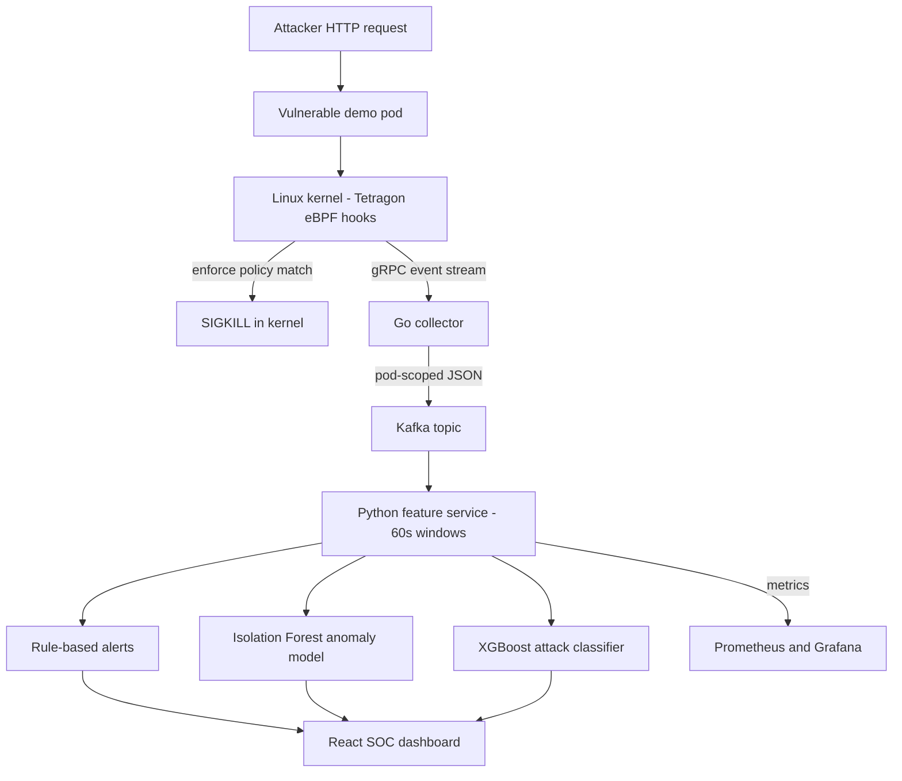
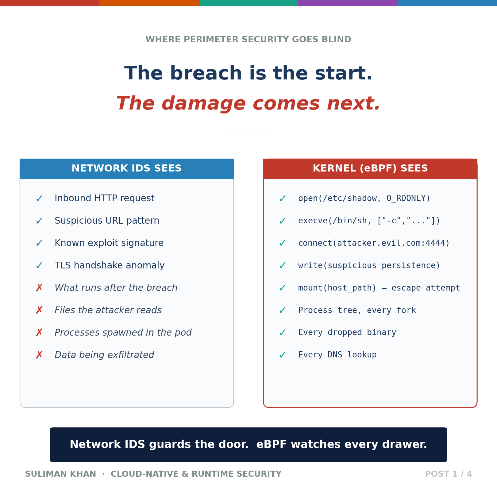
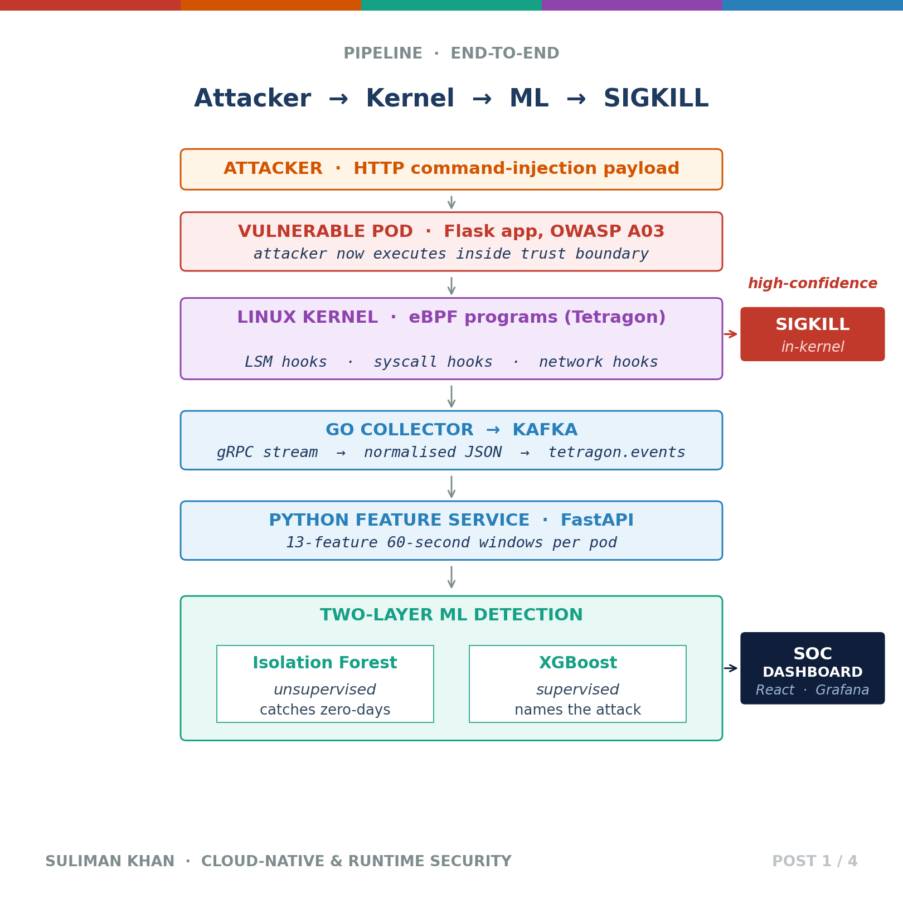

# Kernel-Level Runtime Security Platform

> Watches what happens *inside* running Kubernetes containers at the Linux-kernel level with eBPF. It detects attacks such as credential theft, reverse shells and persistence, scores them with machine learning, and can kill the malicious process in the kernel before the syscall completes.

**Role:** Solo — designed and built end to end · **Status:** Working end to end on a single-node k3s lab (laptop). Cloud (AWS EKS) deployment not done yet; the ML attack classifier is wired in but trained on a very small dataset. · **Source code:** private (walkthrough or live demo available on request)

---

## The problem

Firewalls and network intrusion-detection systems watch packets at the perimeter. Once an attacker gets code running inside a container (for example through a command-injection bug), almost everything they do next is a **Linux syscall**: reading `/etc/shadow`, spawning a shell, connecting to a command-and-control server, or writing an SSH key for persistence. Packet-level tools can't see any of that. Security agents running inside the container can be tampered with by the attacker who now owns the process.

I wanted a second layer that sits **in the kernel**. It should see every process start, sensitive file access and outbound connection from every pod, tell normal from suspicious, and block the worst actions outright.

## What I built

A complete Kubernetes-native detection and response pipeline, from kernel hooks to a SOC-style dashboard, plus an attack lab to prove it works:

- **Kernel sensors:** 7 Tetragon TracingPolicies hooked on Linux LSM hooks and `tcp_connect`. They cover sensitive-file reads, suspicious program execution, connections to known reverse-shell and mining-pool ports, persistence writes, log tampering, container-escape attempts and DNS-tunnelling tools.
- **In-kernel enforcement:** 7 matching *enforce* policies that send `SIGKILL` inside the hook, scoped to the demo namespace.
- **Go event collector:** streams events from Tetragon over gRPC, drops host-level noise, normalises each event to versioned JSON with a trace ID, and publishes it to Kafka keyed by pod. It exposes Prometheus metrics plus health and readiness endpoints.
- **Python feature and detection service (FastAPI):** consumes Kafka and condenses each pod's activity into **60-second windows of 16 numeric features**. Each window is scored by three layers: hand-written rules, an Isolation Forest anomaly model and an XGBoost attack classifier.
- **SOC dashboard (React + TypeScript):** live KPI cards, a MITRE ATT&CK kill-chain row (10 tactics), a per-pod attack timeline and an alerts table with MITRE technique IDs.
- **Operations layer:** Prometheus with 7 alert rules, a Grafana dashboard, and default-deny NetworkPolicies isolating the platform from the workloads it watches.
- **Attack lab:** a deliberately vulnerable Flask app with a command-injection bug, plus scripts for 7 attack scenarios and a 6-step exploit chain launched from outside the cluster.

## Architecture

Tetragon runs eBPF programs on kernel hooks on every node. When a pod triggers an enforce policy (for example writing to `/root/.ssh/authorized_keys`), the kernel kills the process right there. Every policy match is also streamed to the Go collector, which filters out host noise and publishes clean, pod-scoped events to Kafka. The feature service turns those events into per-pod 60-second feature windows. Rules, an unsupervised anomaly model and a supervised classifier then score each window, and the resulting alerts appear on the dashboard and in Prometheus metrics.

## Key features

- **Sees what network tools can't:** file access, process execution and outbound connections inside every pod, captured in the kernel where the workload can't switch it off.
- **Blocks, not just alerts:** enforce policies kill the offending process during the syscall, so the protected file is never read or written.
- **Three detection layers on the same data:** rules (fast and explainable), Isolation Forest (flags unusual behaviour without needing attack labels) and XGBoost (names the attack type when it matches a known pattern).
- **MITRE ATT&CK mapped:** every alert carries a tactic and technique ID (for example TA0011 / T1071.004), which drives the kill-chain view.
- **Traceable end to end:** a trace ID travels from the kernel event through Kafka to the alert, so any alert can be traced back to the exact event that caused it.
- **Hardened API:** bearer-token auth, a second token required for the destructive reset endpoint, CORS locked to the dashboard origin, and rate limiting. Tokens are randomly generated at startup.
- **Model integrity:** models carry version stamps and a SHA-256 hash that is checked at load time. A retraining CronJob template is included.
- **Survives restarts:** alerts persist in SQLite on a persistent volume, and the service resumes from its last committed Kafka offset.

## Results

All results are from my local lab: a single-node k3s cluster on my laptop.

| Result | How it was measured |
|---|---|
| **31 Python + 5 Go unit tests, all passing** | `pytest` and `go test` on the feature service and the collector's event normaliser |
| **Command-injection attack that read `/etc/shadow` detected end to end in under 60 seconds** and shown on the dashboard | Live exploit run against the vulnerable app in detect-only mode, before enforcement was switched on; latency is bounded by the 60-second feature window |
| **Malicious writes killed in the kernel (exit code 137 / SIGKILL)** when writing to `/root/.ssh/authorized_keys` and `/root/.bash_history` | Manual attack runs inside the demo namespace with enforce policies loaded |
| **14 TracingPolicies running** (7 detect + 7 enforce) | Loaded in Tetragon in the lab cluster |
| **About 60% of raw kernel events dropped as host noise** by the collector before reaching Kafka | Early pipeline testing on my desktop machine |
| **Isolation Forest flagged an attack window:** anomaly score -0.658 against a -0.55 threshold, raising an "ML Anomaly" alert | First version of the anomaly model, live attack run |
| **Training data:** 758 benign events (8 windows) and 1,706 attack events | Captured from Kafka under controlled benign-only and attack-only runs |

**Honest limits**

- **Lab-scale, not production.** Everything runs on one k3s node. The cloud (EKS) deployment was planned but deferred for cost reasons. The platform is deployed with plain Kubernetes manifests, and there is no Helm chart yet.
- **The XGBoost classifier is data-starved.** It was trained on only 18 labelled windows (8 benign, 4 credential access, 4 C2/reverse shell, 2 other). That proves the wiring, not accuracy, so I haven't claimed an accuracy number. I added class weighting so it doesn't just default to "benign", but it needs far more data per class.
- **The anomaly baseline is small.** 8 windows of benign traffic from two demo apps is enough to demonstrate the method, not to model "normal" across many services.
- **Enforcement is rule-driven.** The kill policies are static kernel rules scoped to the demo namespace, not triggered by the ML models.
- **Not yet tested against adaptive attackers** who deliberately blend in with normal behaviour.

## Tech stack

| Area | Technologies |
|---|---|
| Kernel and runtime security | Linux eBPF (kprobes, LSM hooks), Cilium Tetragon 1.6, Cilium CNI 1.19 |
| Orchestration | Kubernetes (k3s 1.34), containerd, Docker, distroless images |
| Event pipeline | Go 1.22 (gRPC client, Kafka producer), Apache Kafka 3.7 in KRaft mode |
| Detection and ML | Python, FastAPI, Pydantic, aiokafka, scikit-learn (Isolation Forest), XGBoost, SQLite |
| Dashboard | React 18, TypeScript, Vite, Tailwind CSS |
| Observability | Prometheus 2.54 (alert rules), Grafana 11.1 |
| Platform security | Kubernetes NetworkPolicies (default-deny), bearer auth, rate limiting |
| Testing | pytest, go test |

## Screenshots

Diagrams I made for the project write-up:

**Network IDS vs kernel-level visibility**

**End-to-end pipeline**, from attacker request to in-kernel kill and dashboard. (This graphic was made for a LinkedIn post. It shows the original 13-feature window; the current models use 16 features. The in-kernel kill comes from static enforce rules, not from the ML models.)

## Design decisions

- **LSM hooks instead of raw syscalls.** My first exec rule on `execve` never fired. Under `kubectl exec`, runc calls `execve("/proc/self/fd/N")`, not `/bin/sh`. I switched to the `security_bprm_creds_from_file` LSM hook, which sees the *resolved* binary path (including Alpine's `/bin/sh` → busybox symlink). The same reasoning led me to use `security_file_permission` for file access instead of `openat`.
- **Tetragon over Falco or auditd.** Tetragon can issue `SIGKILL` synchronously inside the kernel hook, so the offending syscall never returns. Falco can only alert after the fact. Tetragon also gets pod metadata from Cilium, which was already in the cluster.
- **Kafka between collector and ML.** If the feature service restarts, it resumes from its last committed offset instead of losing events. A second consumer, such as a SIEM, can read the same stream without code changes. I used KRaft mode and a single partition because there is only one broker, so extra partitions would add complexity without any throughput gain.
- **Rules plus two models, not one.** Rules catch what you expect and are easy to explain. Isolation Forest needs no attack labels, so it can flag new behaviour. XGBoost names the attack when there is enough labelled data. Each layer covers a gap in the others.
- **Static Go binary in a distroless image.** I diagnosed a "no such file or directory" crash in distroless (no dynamic linker) and rebuilt the collector with CGO disabled. The result is a fully static binary in a ~17 MB image with no shell for an attacker to use.

## See it running

Source code is private to protect the work. I'm happy to walk through the code or give a live demo in an interview — contact **sulmn.cs@gmail.com** or [LinkedIn](https://linkedin.com/in/suliman-khan-2b9280251).

© 2026 Suliman Khan. All rights reserved.
