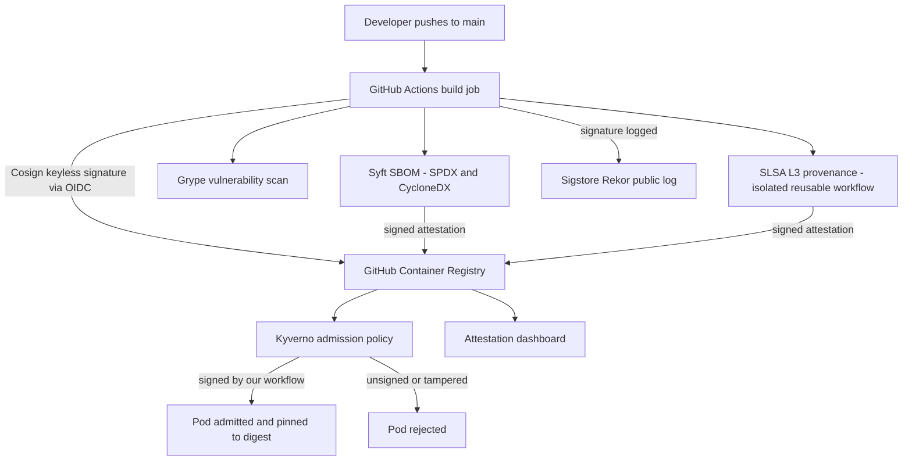

# SLSA Level 3 Supply-Chain Security Platform

> A CI/CD pipeline and Kubernetes admission gate that make every container image carry cryptographic proof of who built it, how it was built and what is inside it. Unsigned or tampered images are refused before they can run.

**Role:** Solo — designed and built end to end · **Status:** v1.0 complete. The CI pipeline runs on GitHub-hosted runners; admission control was demonstrated on a local kind cluster, not a production cluster. · **Source code:** private (walkthrough or live demo available on request)

---

## The problem

Most teams can't prove where a container image came from. If an attacker tampers with an image in the registry, swaps a tag, or slips a malicious dependency into the build (as in the SolarWinds, Codecov and `ua-parser-js` incidents), the cluster will usually run it without question.

The industry answer is the **SLSA framework** combined with **Sigstore** signing. Every artifact should carry verifiable evidence of its source commit, build platform and contents, and the cluster should refuse anything without it. Working, end-to-end examples of this are still rare, so I built one.

## What I built

A reference implementation of a SLSA Build Level 3 supply chain, applied to a real 3-tier demo app (TaskFlow: a React frontend, a Node.js/Express API and PostgreSQL). Every push to `main` builds both application images and passes them through the full chain:

- **Build and sign:** GitHub Actions builds each image with Buildx, pushes it to GitHub Container Registry, and signs it with **Sigstore Cosign in keyless mode**. No long-lived signing key exists anywhere.
- **SLSA L3 provenance:** a separate, isolated job runs the official `slsa-github-generator` (v2.1.0) reusable workflow. It attaches a signed record of exactly how, where and from which commit the image was built.
- **SBOM:** Syft generates a bill of materials in both SPDX and CycloneDX formats. The SPDX SBOM is attached to the image as a signed attestation.
- **Vulnerability scanning:** Grype scans every published image. The full report goes to the job summary and is kept as a build artifact for 30 days.
- **Public transparency:** every signature and attestation is recorded in Sigstore's public, append-only **Rekor** log.
- **Admission control:** a **Kyverno** ClusterPolicy in Enforce mode rejects any pod whose image is not signed by this repository's own GitHub workflow.
- **Attestation dashboard:** a small Python server and a single-page UI pull live signature, provenance, SBOM and CVE data for each image, with a one-click refresh.
- **Security documentation:** a threat model covering 9 threats, a requirement-by-requirement SLSA v1.0 mapping, and a scripted live-demo walkthrough.
- **12 helper scripts** to verify, scan, show the SBOM, simulate an attack and test admission. All are idempotent and safe to re-run.

## Architecture

The build job gets a short-lived certificate from Sigstore's Fulcio CA using the workflow's GitHub OIDC identity, then uses it to sign the image digest. The signature is stored next to the image and logged publicly in Rekor. A separate reusable workflow, which the build job cannot modify, generates and signs the SLSA provenance. At deploy time, Kyverno intercepts the pod request and checks that the image is signed by this repository's workflow, verified by digest and present in Rekor. Only then does it let the pod start, rewriting the tag to the exact verified digest.

## Key features

- **Keyless signing:** each signing certificate is issued for one workflow run and lasts about 10 minutes, so there is no private key to steal or rotate.
- **Signer identity pinned:** Kyverno accepts a signature only if the certificate's issuer is GitHub Actions and its subject matches this repository's workflows. A valid signature from anyone else is rejected.
- **Digest-based verification and pinning:** verification is tied to the image digest, never the tag, and admitted pods are rewritten to that digest. Changing even one byte of an image invalidates it, and tag-swap races are closed.
- **Fail-closed admission:** if the policy engine is unavailable, deployments are blocked rather than allowed through unchecked.
- **Two SBOM formats:** SPDX and CycloneDX, so the output works with most downstream tools.
- **Live attestation dashboard:** per-image tabs for Overview, Signature, Provenance, SBOM and CVEs, plus searchable package and CVE tables, JSON downloads and a "verify it yourself" section with the exact verification commands.
- **Attack simulation:** one script injects a fake "crypto miner" line into the backend, builds and pushes a tampered image, and shows Cosign refusing to verify it.

## Results

Numbers come from the dashboard's live data snapshot (collected 25 April 2026 by running Cosign and Grype against the published images) and from the project's test scripts.

| Result | How it was measured |
|---|---|
| **2 of 2 images signed, with SLSA L3 provenance verified** | `cosign verify` and `cosign verify-attestation` run by the dashboard collector against the registry and Rekor |
| **379 packages inventoried** across both SBOMs (310 backend, 69 frontend) | Signed SPDX SBOM attestations pulled from the registry |
| **134 known CVEs surfaced** (17 backend, 117 frontend). The backend had 0 critical; the frontend's 5 critical were all in Alpine system libraries of its nginx base image | Grype scan of the published images in the same snapshot |
| **Admission test: 3 of 3 cases behaved as expected.** Signed image admitted; tampered image rejected; unsigned tag of the same image rejected | Scripted test against Kyverno 1.13 on a local kind cluster |
| **Tampered image fails verification** ("no matching signatures") | Attack-simulation script: modify, rebuild, push, verify |
| **Threat model:** of 9 threats, 6 mitigated, 1 eliminated by design (no signing key exists), 2 partially mitigated | Written threat model mapping each threat to controls |

**Honest limits**

- **The CVE gate reports but doesn't block yet.** The "fail on critical CVEs that have a fix" step is non-blocking so the SBOM artifacts always upload, and the latest scan did flag fixable critical issues in the frontend's base image. Updating the base image and making the gate blocking is the next step.
- **Admission checks the signature, not everything.** Kyverno verifies signature, signer identity, digest and Rekor inclusion. It doesn't yet require the SLSA provenance attestation or check CVE results at admission; provenance is verified with Cosign in the scripts and dashboard.
- **The policy covers only this project's images.** Third-party images such as a public nginx are outside its scope.
- **Branch protection on `main` isn't enforced** (solo project), so the "compromised workflow" threat is only partly mitigated.
- **Lab cluster only.** Admission control ran on a local kind cluster. Multi-arch images, automatic rebuilds on dependency updates, GitOps deployment and a self-hosted Sigstore stack are listed as stretch goals, not done.

## Tech stack

| Area | Technologies |
|---|---|
| CI/CD | GitHub Actions (OIDC tokens, reusable workflows, job summaries, artifacts), Docker Buildx, GitHub Container Registry |
| Signing and provenance | Sigstore Cosign (keyless), Fulcio, Rekor, slsa-github-generator v2.1.0, in-toto attestations |
| SBOM and scanning | Syft (SPDX, CycloneDX), Grype |
| Admission control | Kyverno 1.13 (verifyImages, digest mutation), Kubernetes via kind |
| Dashboard and tooling | Python 3 HTTP server, HTML/JavaScript, Bash, jq |
| Demo application | React 18 + Vite served by nginx, Node.js 20 + Express, PostgreSQL 16, Docker Compose |

## Design decisions

- **Keyless signing instead of a stored key.** Long-lived signing keys are a classic supply-chain weak point. With keyless signing there is nothing to leak. The trade-off is that verification has to pin the *expected signer identity*, which is why the admission policy matches this repository's workflow path, not just "any valid signature".
- **Provenance from the official reusable workflow, in its own job.** SLSA Level 3 requires that the build can't forge its own provenance. Generating it in a separate job the build job can't touch meets that isolation requirement, rather than me writing a provenance step that the build could influence.
- **Verify and pin by digest, never by tag.** Tags are mutable and digests are not. Signing the digest and having Kyverno rewrite each pod to the verified digest removes the gap between "what was checked" and "what actually runs".
- **Fail closed at admission.** I set the webhook to reject pods when Kyverno can't decide. An outage then blocks deployments instead of letting unverified images in, a trade-off I documented as an accepted risk in the threat model.
- **Private source, public proof.** The source repository is private, but I explicitly opted the provenance into the public Rekor log. Signatures and build records stay independently auditable without exposing the code.

## See it running

Source code is private to protect the work. I'm happy to walk through the code or give a live demo in an interview — contact **sulmn.cs@gmail.com** or [LinkedIn](https://linkedin.com/in/suliman-khan-2b9280251).

© 2026 Suliman Khan. All rights reserved.
